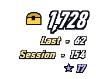
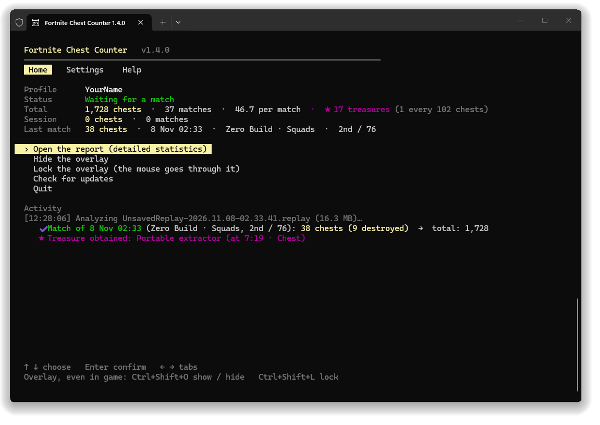

# Fortnite Chest Counter (fork cu verificare de securitate)

 

Numără cuferele pe care le deschizi (sau le spargi) în Fortnite, meci după meci, **citind replay-urile** pe care Fortnite le salvează singur,
și le arată într-un overlay peste joc + un raport HTML.

## De ce nu îți riscă contul

- Citește doar fișierele `.replay` din `%LOCALAPPDATA%\FortniteGame\Saved\Demos`, **doar pentru citire**, după ce se termină meciul.
- **Nu atinge procesul jocului**: nu citește memoria, nu injectează nimic, nu modifică niciun fișier din instalarea Fortnite.
- **Nu atinge contul Epic**: nu are login, token-uri, cookies, nu se uită în folderul Epic Games Launcher.
- **Fără rețea implicit**: verificarea de actualizări e dezactivată din fabrică (o pornești cu `C` dacă vrei).
- Datele rămân local, în `%APPDATA%\ChestCounter`.

Singurul lucru pe care îl face în legătură cu jocul rulat este să verifice dacă procesul `FortniteClient-Win64-Shipping` există în lista de procese (doar pentru opțiunea „Open with Fortnite”, care e opțională).

## Cum îl folosești

1. În Fortnite: *Settings → Game → Replays → Record Replays: **On***.
2. Rulează `ChestCounter.exe` (Windows poate spune „Windows protected your PC”, fiindcă exe-ul nu e semnat: *More info → Run anyway*).
3. Pentru overlay peste joc, pune Fortnite pe **Windowed Fullscreen**.
4. Scurtături: `Ctrl+Shift+O` arată/ascunde overlay-ul, `Ctrl+Shift+L` îl blochează/deblochează, `R` deschide raportul, `C` setări.

Cuferele se adaugă la câteva secunde după fiecare meci, nu în timpul lui (Fortnite scrie cheia replay-ului abia la final).

## Detaliu per meci: tu, echipa și ceilalți jucători

În raport (`R`), la **Dernières parties / Latest matches**, dă click pe orice meci. Se deschide:

- **Echipa ta**: câte cufere ai deschis tu și fiecare coechipier, câte au fost sparte, ce tipuri, plus totalul echipei.
- **Ceilalți jucători văzuți în replay**: cine a deschis câte cufere în meciul respectiv.
- **Cufere tale**: minutul, tipul și ce a ieșit din fiecare.

Coloana **Team** din lista de meciuri arată direct totalul echipei, iar în consolă apare `(team: N)` după fiecare meci.

**Limită importantă:** replay-ul e înregistrat de jocul *tău*, deci conține doar ce a văzut jocul tău. Cuferele deschise departe de tine pot lipsi, așa că
numerele celorlalți jucători (și uneori ale coechipierilor care s-au despărțit de tine) sunt **un minim**, nu un total exact. Numărul tău e cel exact.

La prima pornire cu v1.4.0, replay-urile rămase pe disc se re-analizează automat ca să primești detaliile și pentru meciurile vechi.
Meciurile al căror replay a fost șters rămân în istoric, dar fără detaliul pe jucători.
Numele celorlalți jucători (cele afișate în joc) se salvează doar local, în `data.json`, și nu pleacă nicăieri.

## Ce aduce v1.6.0

Fuziune cu **Chest Counter 1.4.0 de LED-N** (am citit tot codul nou înainte): overlay HUD transparent, consolă nouă, icon în tray, raport nou „logbook"
și **numărătoare corectată** (cufere reumplute, cufere îngropate/relicve, variante numerotate de cufere). Peste ele rămân funcțiile acestui fork:
detaliu pe meci, sezoane, căutare de jucători, raritate, `players.csv`, update oprit implicit și updater restrâns la acest repo.

## Sezoane, căutare de jucători și calitatea loot-ului

În raport:

- **Par saison / By season**: cufere pe sezon (din versiunea jocului din fiecare replay: v42 = Chapter 7 Season 4, v32 = Chapter 2 Remix).
- **Par mode / By mode** și **Avec qui tu joues / Who you play with** (coechipierii tăi cei mai frecvenți și câte cufere deschid).
- **Chercher un joueur / Find a player**: scrii un nume și vezi toate meciurile în care a apărut, cu câte cufere a deschis. Click pe un rezultat deschide meciul.
- **Raritate**: punct colorat pentru ce a ieșit din cufere (gri comun, verde neobișnuit, albastru rar, mov epic, auriu legendar).
- **`players.csv`** în `%APPDATA%\ChestCounter`: un rând per jucător per meci, pentru Excel/Sheets.

## Versiuni

Toate versiunile rămân în [Releases](../../releases), fiecare cu propriul `ChestCounter.exe` și SHA-256-ul lui în descriere.
Ce aduce fiecare versiune e în [`CHANGELOG.md`](CHANGELOG.md). Dacă o versiune nouă nu-ți place, descarci pur și simplu cea veche.

## Build

GitHub Actions rulează testele (`tests/SelfTest`), construiește `ChestCounter.exe` la fiecare push (artefact `ChestCounter`), iar la un tag `v*` îl atașează la Release.
Local: instalează .NET 10 SDK și rulează `build.bat`.

Creditele: [LED-N](https://github.com/LED-N/Fortnite-ChestCounter) (aplicația originală, MIT), [Shiqan](https://github.com/Shiqan/FortniteReplayDecompressor) (parserul de replay, MIT), koiseka (contribuție #6 la originalul).

Vezi [`NOTICE.md`](NOTICE.md) pentru credite și lista modificărilor față de original.
